# VitalKare — Plataforma Hospitalar Inteligente Distribuída

> **Versão do Documento:** 1.0.0  
> **Status:** Especificação Arquitetural — Baseline Oficial  
> **Plataforma de Hardware:** KIIRA V2 (ESP32-S3)  
> **Origem:** Evolução do Projeto Final EmbarcaTech — Capacitação em Sistemas Embarcados  
> **Classificação:** Documento Técnico Interno — Engenharia de Produto

---

## Sumário

1. [Visão Geral do Projeto](#1-visão-geral-do-projeto)
2. [Contexto e Motivação](#2-contexto-e-motivação)
3. [Evolução Arquitetural — Original vs. VitalKare](#3-evolução-arquitetural--original-vs-vitalkare)
4. [Hardware — Placa KIIRA V2](#4-hardware--placa-kiira-v2)
5. [Arquitetura do Sistema](#5-arquitetura-do-sistema)
6. [Firmware Embarcado (ESP32-S3 + FreeRTOS)](#6-firmware-embarcado-esp32-s3--freertos)
7. [Protocolo de Comunicação](#7-protocolo-de-comunicação)
8. [Backend — Arquitetura de Serviços](#8-backend--arquitetura-de-serviços)
9. [Transcrição de Áudio](#9-transcrição-de-áudio)
10. [Dashboard Web](#10-dashboard-web)
11. [Banco de Dados](#11-banco-de-dados)
12. [Regras de Negócio](#12-regras-de-negócio)
13. [Segurança](#13-segurança)
14. [Roadmap de Desenvolvimento](#14-roadmap-de-desenvolvimento)
15. [Evoluções Futuras — IA Embarcada e Analytics](#15-evoluções-futuras--ia-embarcada-e-analytics)
16. [Glossário Técnico](#16-glossário-técnico)

---

## 1. Visão Geral do Projeto

### 1.1 Definição

O **VitalKare** é uma plataforma hospitalar inteligente e distribuída, projetada para modernizar a comunicação e o monitoramento em ambientes clínicos. O sistema substitui modelos tradicionais de chamada de enfermagem por uma rede de nós inteligentes instalados em leitos hospitalares, cada um capaz de capturar áudio, monitorar o ambiente, transmitir vídeo sob demanda e se comunicar em tempo real com uma central de operações.

### 1.2 Propósito

O VitalKare foi concebido para atacar dois problemas centrais em ambientes hospitalares modernos:

- **Fadiga de alarmes:** a sobrecarga de alertas imprecisos ou de baixa urgência que reduz a capacidade de resposta da equipe clínica.
- **Comunicação assimétrica:** a dificuldade dos pacientes em expressar suas necessidades de forma rápida, clara e rastreável.

Ao integrar captura de voz, transcrição automatizada por IA, monitoramento ambiental contínuo e visualização remota sob demanda, o VitalKare cria um canal bidirecional e inteligente entre leito e equipe de saúde.

### 1.3 Escopo Funcional

| Funcionalidade | Descrição |
|---|---|
| Botão de Emergência | Alerta crítico com prioridade máxima e acionamento imediato |
| Gravação de Solicitação | Captura de áudio do paciente com transcrição automática |
| Monitoramento Ambiental | Temperatura, umidade, luminosidade e ruído do quarto |
| Câmera Sob Demanda | Stream e captura de imagem ativados pelo profissional de saúde |
| Display OLED Local | Interface visual no leito com status do paciente e sistema |
| Armazenamento Local | Cartão SD para logs, áudios, imagens e cache offline |
| Dashboard Central | Interface web em tempo real para monitoramento de todos os leitos |
| Heartbeat e Conectividade | Detecção automática de dispositivos offline |
| Log e Auditoria | Registro completo de eventos com timestamp para conformidade |

---

## 2. Contexto e Motivação

### 2.1 Projeto Original — Embarcatech

O projeto original foi desenvolvido para a capacitação EmbarcaTech utilizando a plataforma **BitDogLab (Raspberry Pi Pico W / RP2040)** com firmware em **C/C++** e comunicação via **UDP**.

#### Características do sistema original:

- Terminal de leito com menu de solicitações via joystick
- Display OLED SSD1306 para feedback visual
- Matriz de LEDs WS2812 para sinalização colorida
- Buzzer para alertas sonoros locais
- Detecção de som alto via ADC do microfone
- Envio de mensagens via UDP para dashboard Python/Tkinter
- Dashboard com visualização de eventos e fila de prioridades

#### Limitações identificadas:

| Limitação | Impacto |
|---|---|
| Comunicação UDP sem confirmação de entrega (fire-and-forget) | Eventos críticos podem ser perdidos silenciosamente |
| IP do servidor hardcoded no firmware | Inviabiliza implantação em escala |
| Credenciais Wi-Fi no código-fonte | Risco de segurança em produção |
| Ausência de reconexão automática | Leito fica offline sem notificação |
| Dashboard desktop (Tkinter) | Sem acesso remoto, limitado a um único operador |
| Sem armazenamento local | Logs perdidos sem conectividade |
| Sem captura de áudio real | Menu fixo de opções pré-definidas |
| Sem monitoramento ambiental contínuo | Impossível detectar condições de risco passivamente |
| Sem câmera | Sem visibilidade remota do quarto |
| Sem autenticação | Qualquer dispositivo na rede pode enviar eventos |

### 2.2 Justificativa da Evolução para KIIRA V2

A placa **KIIRA V2**, baseada no **ESP32-S3**, oferece todos os periféricos necessários para superar as limitações do sistema original em um único hardware integrado, eliminando a necessidade de módulos externos e reduzindo pontos de falha.

---

## 3. Evolução Arquitetural — Original vs. VitalKare

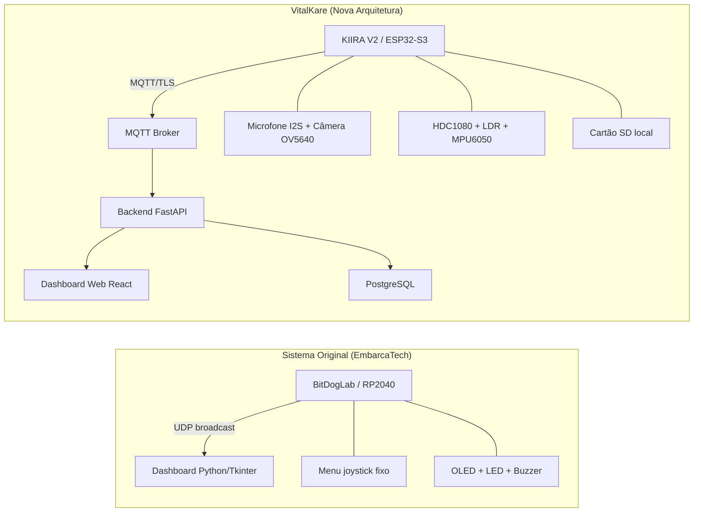

| Dimensão | Sistema Original | VitalKare |
|---|---|---|
| Plataforma | Raspberry Pi Pico W (RP2040) | KIIRA V2 (ESP32-S3) |
| Comunicação | UDP (sem garantia) | MQTT + WebSocket + REST |
| Segurança | Nenhuma | TLS, JWT, RBAC |
| Dashboard | Tkinter desktop | React Web (responsivo) |
| Áudio | Detecção ADC básica | Microfone I2S PDM + gravação |
| Câmera | Não disponível | OV5640 integrada |
| Sensores | Microfone analógico | HDC1080 + LDR + MPU6050 |
| Armazenamento | Nenhum | Cartão SD local |
| IA | Nenhuma | Transcrição Whisper + TinyML futuro |
| Multidispositivo | Não escalável | Arquitetura distribuída N leitos |
| Reconexão | Não implementada | Automática com backoff exponencial |
| Modo offline | Nenhum | Cache local + sync posterior |

---

## 4. Hardware — Placa KIIRA V2

### 4.1 Descrição Geral

A KIIRA V2 é uma plataforma de desenvolvimento educacional baseada no microcontrolador **ESP32-S3 (Dual-core Xtensa LX7)** com suporte nativo a Wi-Fi 802.11 b/g/n, Bluetooth 5.0 LE e aceleração de IA embarcada. A placa integra câmera, microfone digital, display OLED, sensores ambientais, cartão SD, buzzer, relés e outros periféricos em um único PCB.

### 4.2 Especificações do Microcontrolador

| Parâmetro | Especificação |
|---|---|
| Microcontrolador | ESP32-S3 |
| Núcleos | Dual-core Xtensa LX7 |
| Frequência máxima | 240 MHz |
| Conectividade | Wi-Fi 802.11 b/g/n + Bluetooth 5.0 LE |
| Memória PSRAM | Integrada |
| Tensão de operação | 3,3V |
| Interface de programação | USB-C (CDC/JTAG) |
| Aceleração IA | Suporte nativo a operações de inferência |
| Alimentação | USB-C, Vin 9–12V ou Bateria 18650 |

### 4.3 Mapa Completo de Periféricos e GPIOs

| Periférico | Componente | GPIO(s) | Protocolo | Observações |
|---|---|---|---|---|
| Câmera | OV5640 | XCLK: 15, SIOD: 4, SIOC: 5, Y9-Y2: 16,17,18,12,10,8,9,11, VSYNC: 6, HREF: 7, PCLK: 13 | Paralelo + I2C | Alta resolução, visão computacional |
| Microfone Digital | PDM MIC I2S | CLK: 2, DATA: 37 | PDM/I2S | 16 kHz, áudio de qualidade |
| Display OLED | SSD1306 | SDA: 14, SCL: 21 | I2C1 (400 kHz) | 128×64 pixels |
| Sensor Temp/Umidade | HDC1080 | SDA: 14, SCL: 21 | I2C0 (100 kHz), end.: 0x40 | Alta precisão |
| Acelerômetro/Giroscópio | MPU6050 | SDA: 14, SCL: 21 | I2C0 (400 kHz) | 6 eixos, detecção de movimento |
| Cartão SD | SDMMC | CLK: 39, CMD: 38, D0: 40 | SDMMC 1-bit (25 MHz) | Logs, áudio, imagens |
| LDR (Luminosidade) | Fotoresistor | GPIO 1 (ADC1_CH0) | ADC 12-bit (0–4095) | Monitoramento ambiental |
| Trimpot | Potenciômetro | GPIO 1 (ADC1_CH0) | ADC 12-bit | Calibração / entrada analógica |
| Botão A | Push-button | GPIO 45 | Digital, pull-up interno | Solicitação do paciente |
| Botão B | Push-button | GPIO 46 | Digital, pull-up interno | Emergência |
| Entrada Fotoacoplada | Optoacoplador | GPIO 35 | Digital | Input isolado |
| Buzzer/LED | PWM | GPIO 3 | PWM 5 kHz, 10-bit | Selecionável por chave |
| Relé | Relé | GPIO 47 / GPIO 48 | Nível baixo | Acionamento de cargas externas |
| MOSFET | MOSFET OUT | GPIO 47 / GPIO 48 | Nível baixo | Controle de potência |

> **Nota:** O display SSD1306, sensor HDC1080 e MPU6050 compartilham o mesmo barramento I2C (SDA: 14, SCL: 21). O gerenciamento de endereços I2C deve ser realizado por software.

### 4.4 Mapa Funcional do Hardware

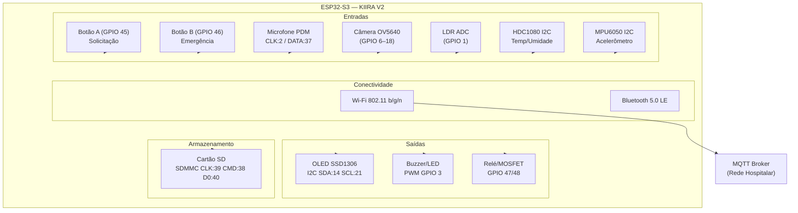

### 4.5 Considerações de Design de Hardware

- O barramento I2C compartilhado entre OLED, HDC1080 e MPU6050 exige gerenciamento cuidadoso de endereços e velocidades de clock. O HDC1080 opera a 100 kHz, limitando o barramento a essa velocidade por padrão.
- O GPIO 1 é compartilhado entre LDR e Trimpot — a seleção deve ser feita por chave física.
- A alimentação por bateria 18650 garante continuidade operacional em caso de queda de energia, aspecto crítico para ambiente hospitalar.
- A seleção entre Relé e MOSFET nos GPIO 47/48 é feita por chave física na placa.

---

## 5. Arquitetura do Sistema

### 5.1 Visão Macro

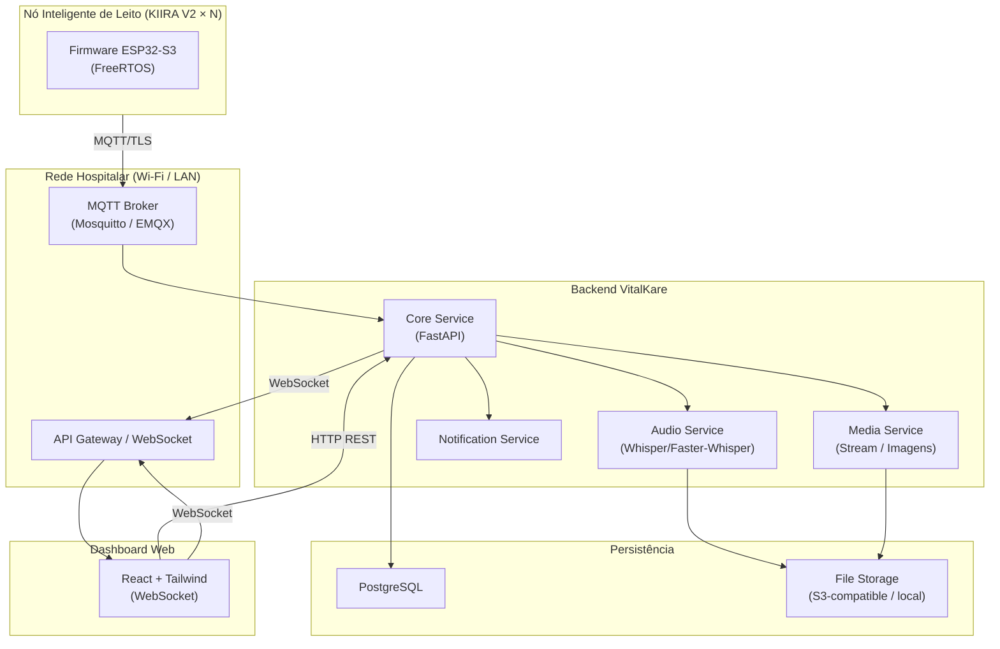

### 5.2 Camadas Arquiteturais

| Camada | Responsabilidade | Tecnologia |
|---|---|---|
| Edge (Nó de Leito) | Captura, processamento local, comunicação | ESP32-S3 + FreeRTOS |
| Transporte | Roteamento de mensagens, broker | MQTT (Mosquitto/EMQX) |
| Backend | Lógica de negócio, persistência, processamento | FastAPI (Python) |
| IA/Áudio | Transcrição, análise | Faster-Whisper |
| Banco de Dados | Persistência estruturada | PostgreSQL |
| Armazenamento de Arquivos | Áudios, imagens, logs binários | MinIO ou sistema de arquivos local |
| Frontend | Visualização, interação do operador | React + Tailwind + WebSocket |

---

## 6. Firmware Embarcado (ESP32-S3 + FreeRTOS)

### 6.1 Justificativa do FreeRTOS

O uso de um RTOS (Real-Time Operating System) é mandatório para o VitalKare pelos seguintes motivos:

- **Determinismo temporal:** eventos críticos (emergência, botão) devem ser processados com latência previsível, independente de outras operações em curso.
- **Concorrência:** captura de áudio, leitura de sensores, comunicação MQTT e exibição no OLED são tarefas independentes que devem ocorrer simultaneamente.
- **Priorização:** tarefas de emergência devem preemptar tarefas de baixa prioridade sem comprometer a estabilidade do sistema.
- **Watchdog:** o FreeRTOS facilita a implementação de watchdogs por task, detectando travamentos individuais.

### 6.2 Estrutura de Diretórios do Firmware

```
vitalkare-firmware/
├── main/
│   ├── main.c                    # Ponto de entrada, init e criação de tasks
│   └── CMakeLists.txt
├── components/
│   ├── core/
│   │   ├── core.c                # Gerenciamento de estado global do sistema
│   │   ├── core.h
│   │   └── system_config.h       # Configurações, constantes, macros
│   ├── network/
│   │   ├── wifi_manager.c        # Conexão Wi-Fi com reconexão automática
│   │   ├── wifi_manager.h
│   │   ├── mqtt_client.c         # Publicação e assinatura MQTT
│   │   └── mqtt_client.h
│   ├── audio/
│   │   ├── audio_capture.c       # Captura PDM/I2S, buffering
│   │   ├── audio_capture.h
│   │   ├── audio_encoder.c       # Compressão (ADPCM/Opus)
│   │   └── audio_encoder.h
│   ├── camera/
│   │   ├── camera_driver.c       # Inicialização OV5640, captura de frame
│   │   ├── camera_driver.h
│   │   ├── stream_handler.c      # MJPEG stream sob demanda
│   │   └── stream_handler.h
│   ├── display/
│   │   ├── oled_driver.c         # Driver SSD1306 I2C
│   │   ├── oled_driver.h
│   │   ├── ui_renderer.c         # Renderização de telas e widgets
│   │   └── ui_renderer.h
│   ├── storage/
│   │   ├── sd_manager.c          # Montagem SDMMC, escrita/leitura
│   │   ├── sd_manager.h
│   │   ├── log_writer.c          # Escrita de logs estruturados
│   │   ├── log_writer.h
│   │   ├── offline_cache.c       # Cache de eventos sem conectividade
│   │   └── offline_cache.h
│   ├── sensors/
│   │   ├── hdc1080.c             # Driver HDC1080 (temp/umidade)
│   │   ├── hdc1080.h
│   │   ├── mpu6050.c             # Driver MPU6050 (acelerômetro)
│   │   ├── mpu6050.h
│   │   ├── ldr.c                 # Leitura ADC LDR (luminosidade)
│   │   └── ldr.h
│   ├── buttons/
│   │   ├── button_handler.c      # Debounce, ISR, eventos
│   │   └── button_handler.h
│   ├── events/
│   │   ├── event_dispatcher.c    # Fila central de eventos
│   │   └── event_dispatcher.h
│   ├── watchdog/
│   │   ├── watchdog.c            # IWDT e watchdog por task
│   │   └── watchdog.h
│   └── ui/
│       ├── screens.c             # Definição das telas do sistema
│       └── screens.h
├── sdkconfig                     # Configuração do ESP-IDF
├── partitions.csv                # Mapa de partições da flash
└── README.md
```

### 6.3 Tasks FreeRTOS

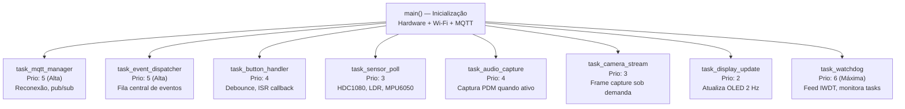

#### Tabela de Tasks e Prioridades

| Task | Prioridade FreeRTOS | Stack (bytes) | Descrição |
|---|---|---|---|
| `task_watchdog` | 6 (máxima) | 2048 | Feed do IWDT, monitora heartbeat das outras tasks |
| `task_mqtt_manager` | 5 | 8192 | Gerencia conexão MQTT, reconexão, publish/subscribe |
| `task_event_dispatcher` | 5 | 4096 | Processa fila central de eventos e roteia ações |
| `task_button_handler` | 4 | 2048 | Processa IRQs de botões com debounce por software |
| `task_audio_capture` | 4 | 16384 | Captura áudio PDM quando ativada, envia buffer |
| `task_sensor_poll` | 3 | 4096 | Lê HDC1080, LDR a cada 30 s; MPU6050 a 10 Hz |
| `task_camera_stream` | 3 | 32768 | Captura e transmite frames JPEG sob demanda |
| `task_display_update` | 2 | 4096 | Renderiza tela OLED a 2 Hz |
| `task_storage_flush` | 1 (baixa) | 4096 | Faz flush periódico do buffer de logs para SD |

### 6.4 Máquina de Estados do Sistema

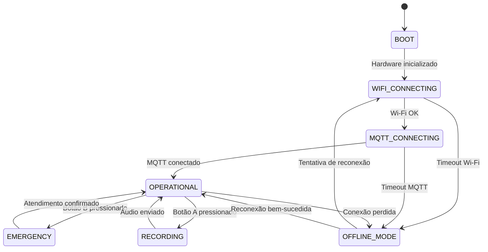

### 6.5 Gerenciamento de Reconexão Wi-Fi/MQTT

O firmware implementa **backoff exponencial com jitter** para reconexão, evitando sobrecarga do broker após falhas de rede coletivas:

```
tentativa_1: aguarda 2 s
tentativa_2: aguarda 4 s
tentativa_3: aguarda 8 s
tentativa_4: aguarda 16 s
tentativa_N: aguarda min(2^N, 120) + jitter(0..5 s)
```

Durante o modo offline, todos os eventos são armazenados no cartão SD e sincronizados com o backend assim que a conexão for restaurada.

### 6.6 Fluxo do Botão de Emergência

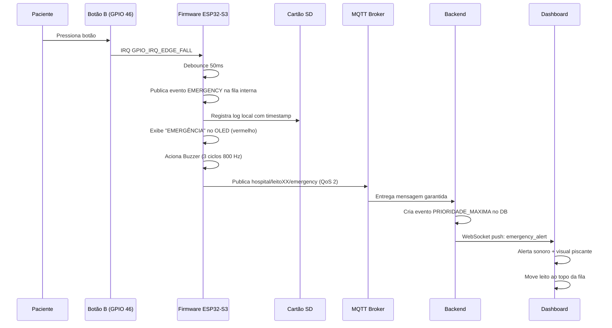

### 6.7 Fluxo do Botão de Solicitação (Gravação de Áudio)

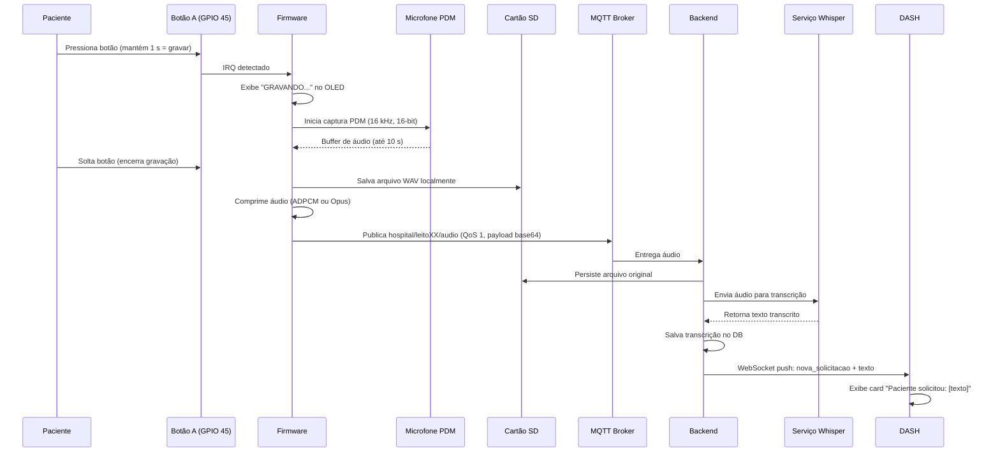

### 6.8 Configuração de Partições da Flash

```
# partitions.csv
# Name,     Type, SubType, Offset,  Size,  Flags
nvs,         data, nvs,     0x9000,  0x6000,
phy_init,    data, phy,     0xf000,  0x1000,
factory,     app,  factory, 0x10000, 0x300000,
ota_0,       app,  ota_0,   0x310000,0x300000,
spiffs,      data, spiffs,  0x610000,0x1F0000,
```

---

## 7. Protocolo de Comunicação

### 7.1 Justificativa — Por que não UDP?

O sistema original utilizava UDP para simplicidade de implementação. No contexto de produção hospitalar, o UDP apresenta restrições inaceitáveis:

| Critério | UDP | MQTT (sobre TCP/TLS) |
|---|---|---|
| Entrega garantida | ❌ Não | ✅ QoS 0/1/2 |
| Ordenação de mensagens | ❌ Não | ✅ Garantida |
| Criptografia nativa | ❌ Não | ✅ TLS 1.2/1.3 |
| Reconexão automática | ❌ Stateless | ✅ Persistent session |
| Publish/Subscribe | ❌ Não | ✅ Nativo |
| Last Will Testament | ❌ Não | ✅ Detecção de desconexão |
| Múltiplos assinantes | ❌ Unicast apenas | ✅ Fan-out nativo |
| Overhead | Mínimo | Baixo (2 bytes header) |

### 7.2 Arquitetura de Comunicação

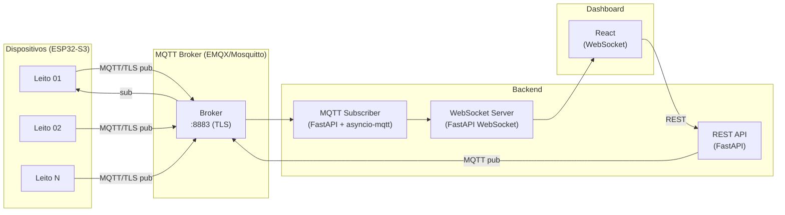

### 7.3 Tópicos MQTT

#### Publicados pelo dispositivo (leito → broker)

| Tópico | QoS | Retenção | Descrição |
|---|---|---|---|
| `hospital/{ward}/leito{id}/status` | 1 | Sim | Heartbeat e status geral |
| `hospital/{ward}/leito{id}/emergency` | 2 | Não | Evento de emergência crítico |
| `hospital/{ward}/leito{id}/request` | 1 | Não | Solicitação de áudio/menu |
| `hospital/{ward}/leito{id}/audio` | 1 | Não | Payload de áudio (base64) |
| `hospital/{ward}/leito{id}/environment` | 1 | Sim | Dados ambientais |
| `hospital/{ward}/leito{id}/image` | 1 | Não | Frame de câmera (JPEG base64) |
| `hospital/{ward}/leito{id}/log` | 0 | Não | Logs de sistema (best-effort) |

#### Publicados pelo backend/dashboard (broker → leito)

| Tópico | QoS | Descrição |
|---|---|---|
| `hospital/{ward}/leito{id}/cmd/camera` | 1 | Solicita captura de imagem ou stream |
| `hospital/{ward}/leito{id}/cmd/ack` | 1 | Confirmação de atendimento |
| `hospital/{ward}/leito{id}/cmd/display` | 1 | Atualiza dados do display OLED |
| `hospital/{ward}/leito{id}/cmd/buzzer` | 1 | Ativa/desativa buzzer remotamente |
| `hospital/broadcast/cmd` | 1 | Comando broadcast para todos os leitos |

#### Last Will Testament (LWT)

Cada dispositivo registra um LWT no MQTT ao conectar:

```json
Topic:   hospital/ala-a/leito01/status
QoS:     1
Retain:  true
Payload: {
  "device_id": "leito01",
  "ward": "ala-a",
  "online": false,
  "reason": "unexpected_disconnect",
  "timestamp": null
}
```

### 7.4 Payloads JSON

#### Status / Heartbeat (`leito{id}/status`)
```json
{
  "device_id": "leito01",
  "ward": "ala-a",
  "patient_id": "PAC-2024-0042",
  "online": true,
  "firmware_version": "1.2.0",
  "uptime_seconds": 86400,
  "wifi_rssi": -62,
  "free_heap_bytes": 187432,
  "sd_free_mb": 7240,
  "timestamp": "2024-11-15T14:30:00Z"
}
```

#### Emergência (`leito{id}/emergency`)
```json
{
  "event_id": "evt-550e8400-e29b-41d4-a716",
  "device_id": "leito01",
  "ward": "ala-a",
  "patient_id": "PAC-2024-0042",
  "event_type": "EMERGENCY",
  "priority": 1,
  "trigger": "BUTTON_B",
  "timestamp": "2024-11-15T14:32:11.234Z",
  "acknowledged": false
}
```

#### Dados Ambientais (`leito{id}/environment`)
```json
{
  "device_id": "leito01",
  "ward": "ala-a",
  "temperature_celsius": 23.4,
  "humidity_percent": 58.2,
  "luminosity_lux": 312,
  "noise_level_db": 42.1,
  "motion_detected": false,
  "timestamp": "2024-11-15T14:30:00Z"
}
```

#### Solicitação de Áudio (`leito{id}/audio`)
```json
{
  "event_id": "evt-a3f2b100-cc4d-4812-b9e1",
  "device_id": "leito01",
  "patient_id": "PAC-2024-0042",
  "event_type": "AUDIO_REQUEST",
  "duration_seconds": 6.2,
  "sample_rate": 16000,
  "encoding": "adpcm",
  "sd_path": "/audio/20241115_143211_leito01.wav",
  "audio_base64": "<base64_encoded_audio>",
  "timestamp": "2024-11-15T14:32:11Z"
}
```

#### Comando — Câmera (`leito{id}/cmd/camera`)
```json
{
  "command": "capture_image",
  "requested_by": "operator-007",
  "request_id": "req-1b2c3d4e",
  "timestamp": "2024-11-15T14:33:00Z"
}
```

#### Confirmação de Atendimento (`leito{id}/cmd/ack`)
```json
{
  "event_id": "evt-550e8400-e29b-41d4-a716",
  "ack_by": "enfermeira-01",
  "ack_time": "2024-11-15T14:33:45Z",
  "notes": "Paciente atendido. Necessitava de água."
}
```

### 7.5 Parâmetros MQTT

| Parâmetro | Valor |
|---|---|
| Protocolo | MQTT 3.1.1 / MQTT 5.0 |
| Porta TLS | 8883 |
| Porta não-segura (dev) | 1883 |
| Keep-alive | 60 s |
| Clean Session | false (sessão persistente) |
| Reconnect Backoff | 2 s a 120 s (exponencial + jitter) |
| QoS Emergência | 2 (exactly once) |
| QoS Heartbeat | 1 (at least once) |
| QoS Logs | 0 (best effort) |

---

## 8. Backend — Arquitetura de Serviços

### 8.1 Stack Tecnológico

| Componente | Tecnologia | Justificativa |
|---|---|---|
| Framework Web | FastAPI (Python 3.11+) | Alta performance, async nativo, auto-documentação OpenAPI |
| MQTT Broker | EMQX Community ou Mosquitto | Escalável, suporte TLS, dashboard de monitoramento |
| WebSocket | FastAPI WebSocket | Integração nativa, baixa latência |
| Banco de Dados | PostgreSQL 16 | Robusto, JSONB para payloads flexíveis, time-series via TimescaleDB |
| Migração | Alembic | Versionamento de schema |
| ORM | SQLAlchemy 2.0 (async) | Type-safe, async-first |
| Cache | Redis | Filas de eventos, sessões, rate limiting |
| Armazenamento de Arquivos | MinIO (S3-compatible) | Self-hosted, compatível com SDK AWS S3 |
| Transcrição IA | Faster-Whisper | Inferência otimizada, suporte a GPU/CPU |
| Containerização | Docker + Docker Compose | Portabilidade, isolamento |
| Mensageria interna | asyncio-mqtt + Redis Streams | Desacoplamento de serviços |

### 8.2 Estrutura de Módulos do Backend

```
vitalkare-backend/
├── app/
│   ├── main.py                   # Ponto de entrada FastAPI, lifespan
│   ├── config.py                 # Configurações via pydantic-settings
│   ├── dependencies.py           # Injeção de dependências (DB, Redis, etc.)
│   │
│   ├── api/
│   │   ├── v1/
│   │   │   ├── routes/
│   │   │   │   ├── patients.py   # CRUD de pacientes
│   │   │   │   ├── beds.py       # CRUD de leitos
│   │   │   │   ├── events.py     # Listagem e ack de eventos
│   │   │   │   ├── audio.py      # Upload e listagem de áudios
│   │   │   │   ├── media.py      # Imagens e stream
│   │   │   │   ├── metrics.py    # Métricas e relatórios
│   │   │   │   └── auth.py       # Login, refresh token
│   │   │   └── websocket.py      # Endpoint WebSocket para dashboard
│   │   └── deps.py
│   │
│   ├── core/
│   │   ├── mqtt_handler.py       # Subscriber MQTT, roteamento de tópicos
│   │   ├── event_processor.py    # Processamento de eventos recebidos
│   │   ├── heartbeat_monitor.py  # Detecção de leitos offline
│   │   └── notification.py      # Push para WebSocket conectados
│   │
│   ├── services/
│   │   ├── audio_service.py      # Orquestra captura → storage → transcrição
│   │   ├── transcription.py      # Interface com Faster-Whisper
│   │   ├── media_service.py      # Processamento de imagens
│   │   └── alert_service.py      # Lógica de priorização e alertas
│   │
│   ├── models/
│   │   ├── patient.py
│   │   ├── bed.py
│   │   ├── event.py
│   │   ├── audio_record.py
│   │   ├── environment_reading.py
│   │   └── operator.py
│   │
│   ├── schemas/                  # Pydantic v2 schemas (request/response)
│   ├── db/
│   │   ├── session.py            # Engine async SQLAlchemy
│   │   └── migrations/           # Alembic
│   └── utils/
│       ├── security.py           # JWT, hashing
│       └── storage.py            # Interface MinIO/S3
│
├── tests/
├── docker-compose.yml
├── Dockerfile
└── requirements.txt
```

### 8.3 Fluxo de Processamento de Evento de Emergência

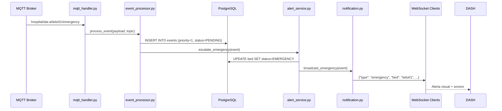

### 8.4 Heartbeat Monitor

O serviço `heartbeat_monitor.py` verifica periodicamente o timestamp do último `status` recebido de cada leito. Caso ultrapasse o threshold configurado (padrão: 90 s), o leito é marcado como `OFFLINE` e um evento é emitido para o dashboard.

```
threshold_offline = 90 s       # Padrão
threshold_critical_offline = 300 s   # Alerta de dispositivo falho
check_interval = 15 s
```

---

## 9. Transcrição de Áudio

### 9.1 Visão Geral do Fluxo

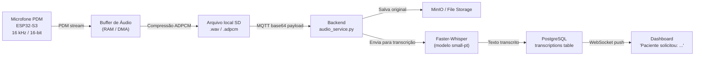

### 9.2 Tecnologias de Transcrição

| Opção | Tipo | Latência | Custo | Privacidade | Recomendação |
|---|---|---|---|---|---|
| **Faster-Whisper** (local) | Self-hosted | 1–3 s (CPU) / <1 s (GPU) | Zero | Total | ✅ Recomendado |
| OpenAI Whisper API | Cloud | 1–2 s | ~$0.006/min | Dados enviados externamente | Desenvolvimento |
| Vosk | Self-hosted offline | <1 s | Zero | Total | Alternativa leve |
| Azure Speech | Cloud | 0.5–1 s | Pago | LGPD/HIPAA compliance | Ambiente corporativo |

**Recomendação primária:** Faster-Whisper com modelo `small` (português). Execução em servidor local da rede hospitalar. Sem envio de dados de pacientes a terceiros, garantindo conformidade com a LGPD.

### 9.3 Parâmetros de Captura de Áudio

| Parâmetro | Valor |
|---|---|
| Taxa de amostragem | 16.000 Hz |
| Profundidade de bits | 16 bits |
| Canais | Mono |
| Duração máxima | 10 s por gravação |
| Formato local (SD) | WAV PCM |
| Formato transmissão | ADPCM (4:1 compressão) ou Opus |
| Tamanho máximo payload MQTT | ~80 KB (10 s ADPCM) |

### 9.4 Exemplo de Resultado de Transcrição

**Entrada:** Gravação de 6 s do paciente  
**Saída no dashboard:**

```json
{
  "transcription_id": "txn-20241115-143211-l01",
  "event_id": "evt-a3f2b100-cc4d-4812-b9e1",
  "bed_id": "leito01",
  "patient_id": "PAC-2024-0042",
  "text": "Eu preciso de água, por favor.",
  "confidence": 0.94,
  "language": "pt",
  "duration_seconds": 6.2,
  "model": "faster-whisper-small",
  "processed_at": "2024-11-15T14:32:18Z"
}
```

**Exibição no dashboard:** `💬 Leito 01 — João Silva: "Eu preciso de água, por favor."`

---

## 10. Dashboard Web

### 10.1 Stack Frontend

| Componente | Tecnologia | Justificativa |
|---|---|---|
| Framework | React 18 + TypeScript | Componentização, tipagem, ecossistema |
| Estilização | Tailwind CSS 3 | Utility-first, responsivo, tematização fácil |
| Estado global | Zustand | Leve, async-friendly |
| WebSocket | Native WebSocket API + React hooks | Tempo real sem polling |
| Gráficos | Recharts + D3.js | Flexível, composable |
| Roteamento | React Router v6 | SPA com rotas protegidas |
| HTTP Client | Axios + React Query | Cache, retry, loading states |
| Notificações | React Hot Toast | Alertas não-intrusivos |
| Autenticação | JWT + cookies httpOnly | Seguro, persistente |

### 10.2 Estrutura de Páginas

| Rota | Página | Descrição |
|---|---|---|
| `/login` | Login | Autenticação do operador |
| `/` | Dashboard Principal | Visão geral de todos os leitos |
| `/bed/:id` | Detalhes do Leito | Histórico, sensores, câmera, transcrições |
| `/events` | Central de Eventos | Fila completa de eventos com filtros |
| `/reports` | Relatórios | Métricas, gráficos, exportação CSV |
| `/settings` | Configurações | Gestão de usuários, leitos, pacientes |
| `/admin` | Administração | Configuração do sistema (admin only) |

### 10.3 Componentes Principais

#### Card de Leito (BedCard)

```
┌─────────────────────────────────────────────┐
│  🛏 LEITO 01 — ALA A                    🟢  │
│  João Silva, 67 anos                         │
├─────────────────────────────────────────────┤
│  🌡 23.4°C  💧 58%  💡 312 lx  🔊 42 dB   │
├─────────────────────────────────────────────┤
│  💬 "Preciso de água, por favor."            │
│  14:32:11 — há 2 min                         │
├─────────────────────────────────────────────┤
│  [✅ Atender]  [📷 Câmera]  [📋 Histórico] │
└─────────────────────────────────────────────┘
```

#### Card de Emergência (estado crítico)

```
╔═════════════════════════════════════════════╗
║  🚨 EMERGÊNCIA — LEITO 03 — ALA B      🔴  ║
║  Maria Aparecida, 82 anos                    ║
║  14:33:45 — há 30 s                          ║
║  ⚠️  AGUARDANDO ATENDIMENTO                 ║
╠═════════════════════════════════════════════╣
║  [🔴 ATENDER AGORA]   [📷 Ver Câmera]       ║
╚═════════════════════════════════════════════╝
```

### 10.4 Arquitetura de Componentes React

```
src/
├── components/
│   ├── layout/
│   │   ├── Sidebar.tsx
│   │   ├── TopBar.tsx
│   │   └── Layout.tsx
│   ├── beds/
│   │   ├── BedCard.tsx           # Card individual de leito
│   │   ├── BedGrid.tsx           # Grade responsiva de leitos
│   │   ├── BedDetails.tsx        # Página detalhada do leito
│   │   └── BedStatusBadge.tsx    # Badge de status (online/offline/emergency)
│   ├── events/
│   │   ├── EventList.tsx         # Lista de eventos com filtros
│   │   ├── EventCard.tsx         # Item individual de evento
│   │   └── AcknowledgeModal.tsx  # Modal de confirmação de atendimento
│   ├── sensors/
│   │   ├── EnvironmentPanel.tsx  # Painel de dados ambientais
│   │   └── SensorChart.tsx       # Gráfico de histórico temporal
│   ├── audio/
│   │   ├── TranscriptionCard.tsx # Exibição de transcrição
│   │   └── AudioPlayer.tsx       # Player de áudio
│   ├── camera/
│   │   ├── CameraModal.tsx       # Modal de visualização de câmera
│   │   └── CameraStream.tsx      # Componente de stream MJPEG
│   ├── alerts/
│   │   ├── EmergencyBanner.tsx   # Banner piscante de emergência
│   │   └── AlertQueue.tsx        # Fila de alertas
│   └── reports/
│       ├── MetricsChart.tsx
│       └── ExportButton.tsx
├── hooks/
│   ├── useWebSocket.ts           # Hook WebSocket com reconnect
│   ├── useBeds.ts                # Estado dos leitos
│   └── useEvents.ts              # Fila de eventos
├── store/
│   ├── bedsStore.ts              # Zustand store: leitos
│   └── alertsStore.ts            # Zustand store: alertas
├── pages/
│   ├── Dashboard.tsx
│   ├── BedDetails.tsx
│   ├── Events.tsx
│   └── Reports.tsx
└── services/
    ├── api.ts                    # Axios instance com interceptors
    └── websocketService.ts       # Singleton WebSocket manager
```

### 10.5 Fluxo de Dados em Tempo Real (WebSocket)

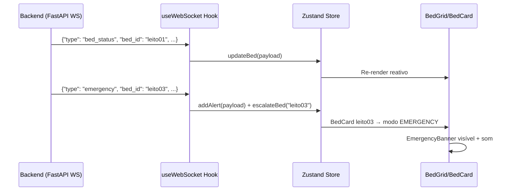

---

## 11. Banco de Dados

### 11.1 Modelo de Dados

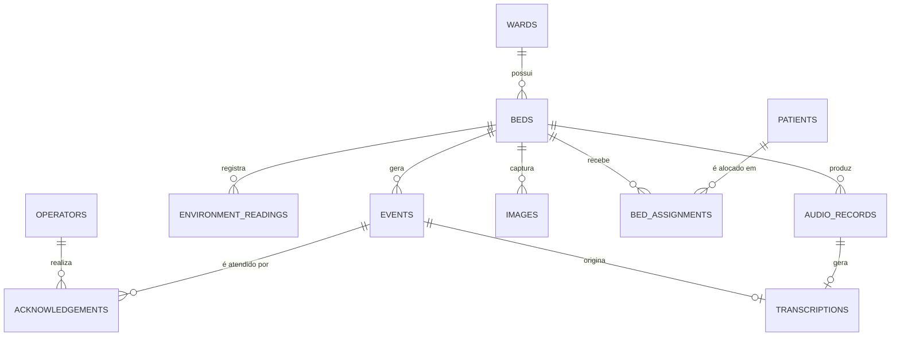

### 11.2 Definição das Tabelas

#### `wards` — Alas Hospitalares

| Coluna | Tipo | Descrição |
|---|---|---|
| `id` | UUID PK | Identificador único |
| `name` | VARCHAR(100) | Nome da ala (ex: "Ala A") |
| `floor` | INT | Andar |
| `capacity` | INT | Número de leitos |
| `created_at` | TIMESTAMPTZ | Data de criação |

#### `beds` — Leitos

| Coluna | Tipo | Descrição |
|---|---|---|
| `id` | UUID PK | Identificador único |
| `ward_id` | UUID FK | Referência à ala |
| `bed_number` | VARCHAR(20) | Identificador legível (ex: "leito01") |
| `device_id` | VARCHAR(50) | Client ID MQTT do dispositivo |
| `status` | ENUM | `ONLINE`, `OFFLINE`, `EMERGENCY`, `OCCUPIED`, `FREE` |
| `last_heartbeat` | TIMESTAMPTZ | Último heartbeat recebido |
| `firmware_version` | VARCHAR(20) | Versão do firmware |
| `metadata` | JSONB | Configurações e informações extras |
| `created_at` | TIMESTAMPTZ | |

#### `patients` — Pacientes

| Coluna | Tipo | Descrição |
|---|---|---|
| `id` | UUID PK | |
| `name` | VARCHAR(200) | Nome completo |
| `birth_date` | DATE | Data de nascimento |
| `admission_date` | TIMESTAMPTZ | Data de internação |
| `discharge_date` | TIMESTAMPTZ | Data de alta (nullable) |
| `medical_record_number` | VARCHAR(50) UNIQUE | Prontuário |
| `notes` | TEXT | Observações clínicas |
| `created_at` | TIMESTAMPTZ | |

#### `bed_assignments` — Alocação de Pacientes

| Coluna | Tipo | Descrição |
|---|---|---|
| `id` | UUID PK | |
| `bed_id` | UUID FK | Referência ao leito |
| `patient_id` | UUID FK | Referência ao paciente |
| `assigned_at` | TIMESTAMPTZ | Início da ocupação |
| `released_at` | TIMESTAMPTZ | Fim da ocupação (nullable) |
| `is_active` | BOOLEAN | Alocação ativa |

#### `events` — Eventos

| Coluna | Tipo | Descrição |
|---|---|---|
| `id` | UUID PK | |
| `bed_id` | UUID FK | Leito de origem |
| `event_type` | ENUM | `EMERGENCY`, `REQUEST`, `AUDIO`, `ENVIRONMENTAL`, `SYSTEM` |
| `priority` | INT | 1 (crítico) a 5 (informativo) |
| `status` | ENUM | `PENDING`, `ACKNOWLEDGED`, `RESOLVED`, `EXPIRED` |
| `payload` | JSONB | Dados brutos do evento |
| `created_at` | TIMESTAMPTZ | Timestamp do evento |
| `resolved_at` | TIMESTAMPTZ | |

#### `acknowledgements` — Confirmações de Atendimento

| Coluna | Tipo | Descrição |
|---|---|---|
| `id` | UUID PK | |
| `event_id` | UUID FK | Evento atendido |
| `operator_id` | UUID FK | Operador que atendeu |
| `ack_at` | TIMESTAMPTZ | Momento do atendimento |
| `response_time_seconds` | INT | Calculado: ack_at - event.created_at |
| `notes` | TEXT | Observações do atendimento |

#### `environment_readings` — Leituras Ambientais

| Coluna | Tipo | Descrição |
|---|---|---|
| `id` | UUID PK | |
| `bed_id` | UUID FK | |
| `temperature_celsius` | FLOAT | |
| `humidity_percent` | FLOAT | |
| `luminosity_lux` | FLOAT | |
| `noise_level_db` | FLOAT | |
| `motion_detected` | BOOLEAN | |
| `recorded_at` | TIMESTAMPTZ | Timestamp da leitura |

> **Nota:** Para ambiente de produção, recomenda-se a extensão **TimescaleDB** para otimização de queries time-series sobre `environment_readings`.

#### `audio_records` — Registros de Áudio

| Coluna | Tipo | Descrição |
|---|---|---|
| `id` | UUID PK | |
| `event_id` | UUID FK | Evento relacionado |
| `bed_id` | UUID FK | |
| `file_path` | VARCHAR(500) | Caminho no storage |
| `duration_seconds` | FLOAT | |
| `sample_rate` | INT | |
| `file_size_bytes` | BIGINT | |
| `checksum_sha256` | VARCHAR(64) | Integridade |
| `created_at` | TIMESTAMPTZ | |

#### `transcriptions` — Transcrições

| Coluna | Tipo | Descrição |
|---|---|---|
| `id` | UUID PK | |
| `audio_record_id` | UUID FK | |
| `text` | TEXT | Texto transcrito |
| `confidence` | FLOAT | Score de confiança (0–1) |
| `language` | VARCHAR(10) | Código de idioma (pt-BR) |
| `model_used` | VARCHAR(100) | Ex: faster-whisper-small |
| `processing_time_ms` | INT | Tempo de processamento |
| `created_at` | TIMESTAMPTZ | |

#### `operators` — Operadores / Equipe

| Coluna | Tipo | Descrição |
|---|---|---|
| `id` | UUID PK | |
| `name` | VARCHAR(200) | |
| `email` | VARCHAR(200) UNIQUE | |
| `role` | ENUM | `ADMIN`, `NURSE`, `DOCTOR`, `VIEWER` |
| `password_hash` | VARCHAR(200) | bcrypt |
| `is_active` | BOOLEAN | |
| `last_login` | TIMESTAMPTZ | |
| `created_at` | TIMESTAMPTZ | |

---

## 12. Regras de Negócio

### 12.1 Prioridade de Eventos

| Nível | Tipo de Evento | Ação no Dashboard | TTL sem Ack |
|---|---|---|---|
| **P1 — CRÍTICO** | Emergência (botão B) | Alerta visual piscante, som contínuo, leito no topo | 120 s → re-alerta |
| **P2 — ALTO** | Som alto detectado (futuro) | Card destacado, som único | 300 s |
| **P3 — MÉDIO** | Solicitação de áudio | Card normal com transcrição | 600 s |
| **P4 — BAIXO** | Solicitação de menu (texto fixo) | Card padrão na fila | 900 s |
| **P5 — INFO** | Dados ambientais fora do range | Indicador discreto | Sem TTL |

### 12.2 Fila de Eventos

- Eventos são ordenados primariamente por **prioridade** e secundariamente por **timestamp** (FIFO dentro da mesma prioridade).
- Um evento P1 recém-criado sempre ocupa o topo da fila, empurrando eventos P1 anteriores para baixo em caso de múltiplas emergências simultâneas — a mais recente fica no topo dentro de P1.
- Eventos `ACKNOWLEDGED` são removidos da fila ativa e movidos ao histórico.
- Eventos `EXPIRED` (sem ack após TTL) são escalados: geram novo evento de nível superior e uma notificação de re-alerta.

### 12.3 Heartbeat e Detecção de Offline

```
Dispositivo publica: hospital/{ward}/{id}/status a cada 30 s
Backend monitora: se não receber em 90 s → marca OFFLINE
Se não receber em 300 s → gera evento P2 "DISPOSITIVO_OFFLINE"
Ao reconectar: marca ONLINE + sincroniza eventos em cache do SD
```

### 12.4 Modo Offline do Dispositivo

Quando o dispositivo perde conectividade Wi-Fi ou MQTT:

1. Continua operando localmente em modo degradado
2. Todos os eventos são armazenados no SD com timestamp local
3. O OLED exibe indicador de modo offline
4. O Buzzer emite sinal de aviso (1 bip a cada 60 s)
5. Ao reconectar, o cache é sincronizado com o backend em ordem cronológica
6. Eventos P1 do período offline são promovidos com flag `offline_delayed`

### 12.5 Confirmação de Atendimento

1. Operador visualiza evento no dashboard
2. Clica em "Atender" → abre modal de confirmação
3. Pode adicionar notas de atendimento
4. Backend atualiza status do evento para `ACKNOWLEDGED`
5. Backend publica `hospital/{ward}/{id}/cmd/ack` com dados do operador
6. Dispositivo exibe confirmação no OLED por 5 s
7. `response_time_seconds` é calculado e salvo para métricas

### 12.6 Encerramento de Ocorrência

1. Após confirmação, evento entra em status `ACKNOWLEDGED`
2. Operador pode adicionar resolução → status `RESOLVED`
3. Ocorrências P1 sem resolução após 30 min geram alerta de acompanhamento
4. Log de auditoria completo: criação → ack → resolução

### 12.7 Controle de Câmera

- A câmera **nunca transmite continuamente** por padrão (privacidade e largura de banda)
- Operador solicita captura ou stream via dashboard
- Backend publica comando MQTT para o dispositivo
- Stream dura no máximo 5 minutos antes de requerer nova solicitação
- Todo acesso à câmera é registrado em log de auditoria com operador, timestamp e duração

---

## 13. Segurança

### 13.1 Autenticação e Autorização

| Mecanismo | Aplicação |
|---|---|
| JWT (RS256) | Autenticação de operadores no dashboard e API REST |
| Refresh Token | Renovação silenciosa de sessão (24 h) |
| RBAC | Controle de acesso por papel (ADMIN, NURSE, DOCTOR, VIEWER) |
| mTLS (futuro) | Certificados de dispositivo para autenticação MQTT |
| API Keys | Integrações de sistema (ex: HIS hospitalar) |

#### Matriz de Permissões RBAC

| Ação | VIEWER | NURSE | DOCTOR | ADMIN |
|---|---|---|---|---|
| Visualizar leitos | ✅ | ✅ | ✅ | ✅ |
| Atender evento | ❌ | ✅ | ✅ | ✅ |
| Solicitar câmera | ❌ | ✅ | ✅ | ✅ |
| Ver transcrições | ✅ | ✅ | ✅ | ✅ |
| Exportar relatórios | ❌ | ✅ | ✅ | ✅ |
| Gerenciar pacientes | ❌ | ✅ | ✅ | ✅ |
| Gerenciar operadores | ❌ | ❌ | ❌ | ✅ |
| Configurar dispositivos | ❌ | ❌ | ❌ | ✅ |

### 13.2 Segurança da Comunicação

| Canal | Proteção |
|---|---|
| MQTT Broker | TLS 1.3, porta 8883, certificado do servidor |
| API REST | HTTPS (TLS 1.2+), HSTS, CORS configurado |
| WebSocket | WSS (WebSocket Secure) |
| Dashboard | HTTPS obrigatório |
| Banco de Dados | Conexão TLS interna, credenciais via secrets |
| Armazenamento | Buckets privados, URLs pré-assinadas com TTL |

### 13.3 Proteção de Dados (LGPD)

- Dados de pacientes (nome, prontuário) são armazenados separadamente dos dados de eventos
- Áudios e imagens são associados ao paciente via ID, nunca com nome em metadados de arquivo
- Retenção configurável: logs de eventos (90 dias), áudios (30 dias), imagens (7 dias) — configurável
- Direito de exclusão: fluxo implementado para anonimização de dados históricos
- Acesso auditado: todo acesso a dados sensíveis é registrado com operador e timestamp

### 13.4 Segurança do Dispositivo

- Credenciais Wi-Fi e MQTT armazenadas em partição NVS criptografada do ESP32-S3
- Firmware assinado digitalmente para OTA (Over-The-Air updates)
- Watchdog de hardware previne travamentos indefinidos
- Botão de reset físico apenas apaga configurações de rede, não o histórico local

### 13.5 Segurança da Câmera

- Stream apenas sob demanda autenticada (nunca automático)
- Logs de auditoria de todos os acessos: operador, timestamp, duração
- Stream com TTL (timeout em 5 min)
- Permissão mínima: papel NURSE ou superior

---

## 14. Roadmap de Desenvolvimento

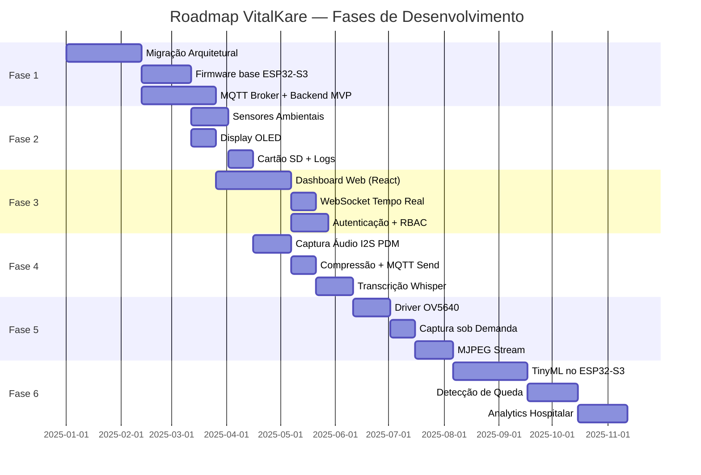

### Fase 1 — Migração Arquitetural (Semanas 1–10)

**Objetivo:** Substituir a arquitetura UDP/Tkinter por MQTT/FastAPI/React com funcionalidades equivalentes ao sistema original.

- [ ] Configurar ambiente de desenvolvimento ESP-IDF + FreeRTOS
- [ ] Implementar `task_wifi_manager` com reconexão automática
- [ ] Implementar `task_mqtt_client` com QoS e LWT
- [ ] Portar lógica de botões (A = solicitação, B = emergência) para o novo hardware
- [ ] Configurar MQTT Broker (Mosquitto local)
- [ ] Criar endpoints REST básicos (FastAPI)
- [ ] Implementar heartbeat monitor no backend
- [ ] Dashboard React com grid de leitos e WebSocket

**Critério de aceite:** Sistema equivalente ao original funcionando na nova arquitetura.

### Fase 2 — Sensores e Armazenamento (Semanas 11–17)

**Objetivo:** Adicionar monitoramento ambiental contínuo e armazenamento local resiliente.

- [ ] Driver HDC1080 (temperatura + umidade)
- [ ] Leitura ADC do LDR (luminosidade)
- [ ] Driver MPU6050 (detecção de movimento)
- [ ] Implementar `task_sensor_poll` com publicação MQTT periódica
- [ ] Inicialização SDMMC e sistema de arquivos FAT
- [ ] `log_writer.c` para logs estruturados em CSV/JSON no SD
- [ ] `offline_cache.c` para armazenar eventos sem conectividade
- [ ] Sincronização de cache ao reconectar
- [ ] OLED exibindo temp, umidade, status e informações do paciente

**Critério de aceite:** Dados ambientais visíveis em tempo real no dashboard; dispositivo opera com resiliência a quedas de conectividade.

### Fase 3 — Dashboard Web Completo (Semanas 12–20)

**Objetivo:** Dashboard responsivo e funcional para operação em produção.

- [ ] Layout responsivo com grid de BedCards
- [ ] Indicadores em tempo real (status, sensores, alertas)
- [ ] Fila de eventos com priorização visual
- [ ] Modal de atendimento com notas
- [ ] Histórico de eventos com filtros e busca
- [ ] Autenticação JWT + RBAC completo
- [ ] Página de configurações (pacientes, leitos)
- [ ] Exportação de relatórios CSV

**Critério de aceite:** Dashboard operacional com todos os leitos monitorados simultaneamente.

### Fase 4 — Áudio e Transcrição (Semanas 18–24)

**Objetivo:** Captura de voz do paciente com transcrição automática por IA.

- [ ] Driver microfone PDM I2S (GPIO 2/37)
- [ ] Buffer de captura com DMA para gravação eficiente
- [ ] Compressão ADPCM para redução do payload MQTT
- [ ] Envio de áudio via MQTT (payload fragmentado se necessário)
- [ ] Deploy Faster-Whisper no servidor backend
- [ ] Serviço de transcrição assíncrono
- [ ] Exibição de transcrições no dashboard com contexto
- [ ] Armazenamento de áudios no MinIO

**Critério de aceite:** Paciente pressiona botão → fala → texto aparece no dashboard em menos de 5 s.

### Fase 5 — Câmera e Stream (Semanas 22–30)

**Objetivo:** Visualização remota e segura do quarto hospitalar sob demanda.

- [ ] Inicialização e configuração do driver OV5640
- [ ] Captura de frame JPEG estático
- [ ] Transmissão base64 via MQTT para imagem única
- [ ] Servidor MJPEG stream no ESP32-S3 (HTTP)
- [ ] Integração com dashboard (modal de câmera)
- [ ] Controle de TTL e autorização de acesso
- [ ] Log de auditoria de acessos à câmera

**Critério de aceite:** Operador solicita câmera no dashboard → visualiza feed em menos de 3 s.

### Fase 6 — IA Embarcada (Semanas 28–42)

**Objetivo:** Inferência local no ESP32-S3 para detecção passiva de eventos.

- [ ] Avaliação de modelos TinyML (TensorFlow Lite for Microcontrollers)
- [ ] Classificador de áudio: detecção de gritos e choro
- [ ] Detecção de queda via MPU6050 + modelo de ML
- [ ] Pipeline de treinamento e conversão de modelos
- [ ] Deploy e inferência no ESP32-S3
- [ ] Integração de eventos inferidos com a fila do sistema

---

## 15. Evoluções Futuras — IA Embarcada e Analytics

### 15.1 Detecção de Queda

O acelerômetro MPU6050 integrado à KIIRA V2 é capaz de detectar padrões de aceleração característicos de uma queda. A evolução prevê:

- Algoritmo de detecção baseado em threshold de aceleração brusca (>3g)
- Modelo de ML embarcado (TinyML) para redução de falsos positivos
- Integração como evento P1 automático no sistema VitalKare
- Correlação com câmera: captura de imagem automática após detecção

### 15.2 Detecção de Gritos e Voz de Angústia

Utilizando o microfone PDM e TensorFlow Lite for Microcontrollers:

- Classificador de áudio ambiente treinado com amostras de gritos, chamados e conversação normal
- Inferência contínua de baixo consumo em segundo plano
- Ativação de alerta sem necessidade de pressionar botão
- Dataset: Google AudioSet + amostras hospitalares anonimizadas

### 15.3 Análise Comportamental por Visão Computacional

Com o OV5640 e modelos leves (MobileNet V2 quantizado):

- Detecção de presença/ausência no leito
- Detecção de postura (deitado, sentado, de pé)
- Monitoramento passivo de movimentação noturna
- Privacidade garantida: inferência local, sem transmissão de imagens em modo passivo

### 15.4 Analytics Hospitalar

Com a acumulação de dados no PostgreSQL, evoluções previstas incluem:

- **Dashboard de métricas clínicas:** tempo médio de resposta por turno, por ala, por tipo de evento
- **Análise de padrões:** horários de pico de chamados, tipos mais frequentes por perfil de paciente
- **Relatórios de conformidade:** aderência a SLAs de atendimento
- **Detecção de anomalias:** alertas para mudanças bruscas em dados ambientais (temperatura, ruído)
- **Predição de demanda:** modelo de ML para prever picos de solicitações por turno

### 15.5 Visão de Longo Prazo

| Evolução | Horizonte | Tecnologia |
|---|---|---|
| Integração com HIS (Sistema de Informação Hospitalar) | 12 meses | HL7 FHIR API |
| App mobile para enfermagem | 12 meses | React Native |
| Monitoramento de sinais vitais (SpO2, ECG externo) | 18 meses | Sensores via I2C/SPI |
| Análise de qualidade do sono | 18 meses | MPU6050 + ML |
| Reconhecimento de identidade do paciente | 24 meses | OV5640 + FaceNet embarcado |
| Multitenancy (múltiplas unidades hospitalares) | 24 meses | Arquitetura SaaS |

---

## 16. Glossário Técnico

| Termo | Definição |
|---|---|
| **KIIRA V2** | Placa de desenvolvimento baseada em ESP32-S3 com periféricos integrados para IoT e IA embarcada |
| **ESP32-S3** | Microcontrolador dual-core Xtensa LX7 da Espressif com Wi-Fi, BLE e suporte a IA |
| **FreeRTOS** | Sistema operacional de tempo real utilizado no firmware do VitalKare |
| **MQTT** | Protocolo de mensageria publish/subscribe leve, ideal para IoT com garantias de entrega |
| **QoS** | Quality of Service — nível de garantia de entrega do MQTT (0, 1 ou 2) |
| **LWT** | Last Will Testament — mensagem MQTT publicada automaticamente ao desconectar |
| **TLS** | Transport Layer Security — protocolo de criptografia para comunicação segura |
| **PDM** | Pulse Density Modulation — método de captura de áudio digital usado no microfone da KIIRA |
| **SDMMC** | Interface para cartão SD em modo SDMMC (mais rápido que SPI) |
| **OV5640** | Sensor de câmera CMOS de 5 MP integrado à KIIRA V2 |
| **HDC1080** | Sensor I2C de temperatura e umidade de alta precisão da Texas Instruments |
| **MPU6050** | Acelerômetro e giroscópio de 6 eixos da InvenSense via I2C |
| **SSD1306** | Controlador de display OLED 128×64 da Solomon Systech |
| **FastAPI** | Framework web Python assíncrono de alta performance para criação de APIs REST |
| **Faster-Whisper** | Implementação otimizada do modelo Whisper da OpenAI para transcrição de fala |
| **TinyML** | Machine Learning embarcado em microcontroladores de recursos limitados |
| **MJPEG** | Motion JPEG — formato de stream de vídeo por sequência de imagens JPEG |
| **RBAC** | Role-Based Access Control — controle de acesso baseado em papéis |
| **JWT** | JSON Web Token — padrão para autenticação stateless |
| **MinIO** | Servidor de armazenamento de objetos compatível com S3, self-hosted |
| **TimescaleDB** | Extensão do PostgreSQL otimizada para dados de séries temporais |
| **LGPD** | Lei Geral de Proteção de Dados Pessoais (Lei 13.709/2018) |
| **ADPCM** | Adaptive Differential Pulse-Code Modulation — codec de compressão de áudio |
| **Backoff Exponencial** | Estratégia de reconexão que dobra o intervalo de espera a cada tentativa fracassada |
| **Edge Computing** | Processamento de dados realizado no dispositivo, próximo à fonte, sem depender da nuvem |
| **OTA** | Over-The-Air — atualização de firmware remotamente via rede Wi-Fi |

---

*Documento elaborado como especificação arquitetural do projeto VitalKare.*  
*Versão 1.0.0 — Baseline Oficial para desenvolvimento.*  
*Baseado na análise do projeto original EmbarcaTech e na documentação técnica da placa KIIRA V2.*